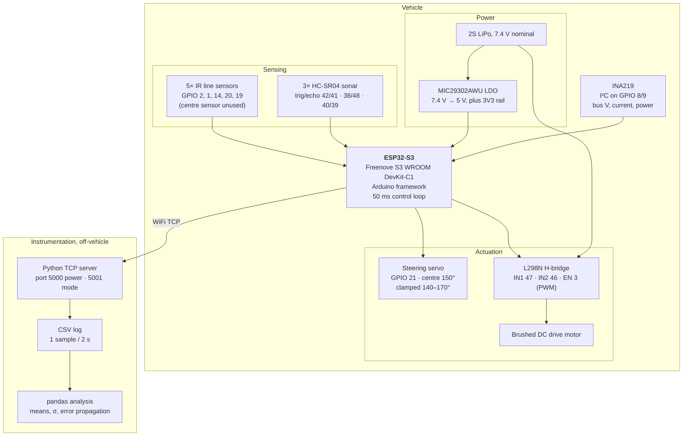
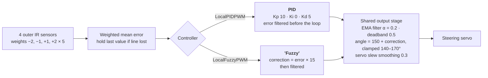

# Autonomous Energy-Efficient Vehicle

A self-driving line-following car on a custom ESP32-S3 carrier PCB, built to answer
one question: **does the choice of steering controller measurably change how much
power the vehicle draws?**

Two steering controllers were written, run on the same physical track, and
instrumented with an INA219 current monitor streaming over WiFi to a logging
server. ESP32 sleep modes were characterised separately and folded into the power
budget.

> **Everything in this repository was measured on real hardware.** There are no
> simulations. The headline finding is a negative result: the measured power
> difference between the two controllers (~129 mW) is an order of magnitude
> smaller than the measurement uncertainty (~±1600–1900 mW), so **the two
> controllers are indistinguishable on power** with this rig.

---

## System overview



**Behaviour.** The IR array reads the line and produces a weighted position error.
A steering controller converts that error into a servo angle. Three forward-facing
sonars stop the drive motor if anything is within 10 cm; otherwise the motor runs
at a fixed duty. There is no speed control loop — steering is the only closed loop.

---

## Hardware

### The PCB

A **2-layer KiCad board** (`F.Cu` / `B.Cu` only) acting as a carrier and power
board for the Freenove ESP32-S3 devkit, breaking the GPIO out to labelled
peripheral connectors.

| Item | Detail |
|---|---|
| Layers | 2 (top / bottom copper) |
| MCU carrier | 2× 20-pin headers for the Freenove S3 WROOM module |
| Regulation | `MIC29302AWU` LDO, 7.4 V in → 5 V, with a 3V3 rail; 165 R / 500 R feedback divider, 10 µF / 22 µF bulk |
| Break-outs | IR array, HC-SR04, servo, motor driver, camera (CSI), SPI SRAM, USB host, UART / boot |
| Debug | 12 test points |
| Revisions | `CarPCB.zip` (earlier), `NewCarPCB.zip` (current under `Project/`, earlier kept under `OLD/`) |
| Outputs | KiCad `.kicad_sch` / `.kicad_pcb` / `.kicad_pro` + schematic PDF |

The board was designed as a carrier, not a full integration — the ESP32-S3 devkit,
the L298N motor driver and the sensors are modules that plug into it.

**Not present:** no Gerbers, drill files, pick-and-place or BOM are committed.
There is no assembly or bring-up documentation, and no fabrication or bare-board
test evidence in the repo.

### MCU

**ESP32-S3** on a Freenove S3 WROOM DevKit-C1, programmed with the Arduino
framework. Both controllers are single `.ino` sketches; there is no RTOS task
structure, no interrupts, and no watchdog — the control loop is a blocking
`loop()` with `delay(50)`.

### Sensors

| Sensor | Interface | Role |
|---|---|---|
| 5× IR reflectance | Digital GPIO 2, 1, 14, 20, 19 | Line position. **Only 4 are used** — the centre sensor (GPIO 14) is initialised then ignored |
| 3× HC-SR04 ultrasonic | Trig/echo pairs, 30 ms `pulseIn` timeout | Obstacle stop at < 10 cm |
| INA219 | I²C, GPIO 8 (SDA) / 9 (SCL) | Bus voltage, current, power for the energy study |

Sonar is read with three blocking `pulseIn()` calls per loop iteration, each with
a 30 ms timeout — so a missing echo on all three stalls the loop for up to 90 ms
on top of the 50 ms delay. A `-1` timeout is treated as "obstacle present", so a
lost echo stops the car.

### Drive

Steering is a hobby servo on GPIO 21. Propulsion is a brushed DC motor through an
**L298N** H-bridge: direction on GPIO 47/46, speed on the enable pin (GPIO 3).
Both the servo and the motor PWM are driven through the `ESP32Servo` library —
which is why the vendored `ESP32Servo-master.zip` must be installed manually (see
[Setup](#setup)).

Power comes from a **2S LiPo at 7.4 V nominal**; logged bus voltage sits at
7.7–7.9 V when the INA219 reads valid.

---

## The two controllers

Both sketches share an identical sensing front-end, output stage and loop rate.
They differ *only* in how position error becomes a steering correction.



### `LocalPIDPWM.ino` — PID

`Kp = 10.0`, `Ki = 0.0`, `Kd = 5.0`, with `dt` measured from `millis()`. Because
the integral gain is zero, **this is a PD controller in practice** — the integral
term is computed and accumulated every iteration but multiplied by zero.

### `LocalFuzzyPWM.ino` — labelled "fuzzy"

> **This controller contains no fuzzy logic.** There are no membership functions,
> no linguistic variables, no rule base and no defuzzification step. The entire
> control law is `correction = error * 15.0`, which is **proportional control with
> a gain of 15**. The file name and comments call it fuzzy; the code does not
> implement it. This should be described as a P controller, not a fuzzy
> controller, anywhere the project is written up.

So the comparison that was actually run is **PD (Kp 10, Kd 5) vs. P (Kp 15)**.

### How they were compared

1. Flash one sketch, run the car on the same line-following track.
2. The INA219 samples bus voltage / current / power; the ESP32 pushes a
   `power,current,voltage` CSV line over WiFi TCP to a Python server
   (`PowerMeasurement.py` / `PowerMeasurementV2.py`) **once every 2 s**.
3. The server timestamps and appends to CSV.
4. `PIZFuzzyAverage.py` computes per-column means; `ErrorAnalysisPIDFuzzy.py`
   computes means, standard deviations, `P = V̄ · Ī`, and propagates uncertainty as
   `ΔP = P · √((σ_V/V̄)² + (σ_I/Ī)²)`.
5. Sleep-mode power is characterised separately and added on
   (`Power Calculations.docx`), combining errors in quadrature.

**Confounds in the comparison, stated plainly.** The two runs are not
like-for-like:

| | PID run | "Fuzzy" run |
|---|---|---|
| Duration / samples | 6.0 min, 180 samples | 11.2 min, 336 samples |
| `maxMotorSpeed` | **240** | **255** |
| `motorPulseMin/Max` | 8000 / 8000 µs | 10000 / 10000 µs |

The drive duty differs by ~6% between the two runs, and the servo pulse-range
constants differ. Since the drive motor dominates the power draw, **some of the
measured difference is attributable to the motor settings rather than to the
controller.** In both sketches `motorPulseMin == motorPulseMax`, which collapses
the `ESP32Servo` pulse range to a single value — the "PWM duty" is not doing what
the variable names suggest.

---

## Results

### What "error analysis" means here

The error analysis in this repository is **measurement uncertainty on power** —
standard deviations of the logged V and I, propagated through `P = V·I`. It is
**not** control-loop error analysis: there is no measurement of line-tracking
error, settling time, overshoot or steady-state deviation, because ground-truth
lateral position was never instrumented. No controller-performance metric was
recorded for either controller.

### Power consumption

As reported by `ErrorAnalysisPIDFuzzy.py` (output preserved in
`PowerErrorAnalysis.txt`) and `PWRAverageResults.txt`:

| Controller | Mean power, logged (mW) | σ (mW) | Mean current (mA) | σ (mA) | Mean bus V | σ (V) | P = V̄·Ī (mW) | ΔP (mW) |
|---|---|---|---|---|---|---|---|---|
| PID (PD) | 2664.5 | 1368.2 | 344.3 | 187.3 | 6.56 | 2.95 | 2260.1 | ±1593.6 |
| "Fuzzy" (P) | 2793.5 | 1823.7 | 350.9 | 261.8 | 6.02 | 3.22 | 2113.0 | ±1939.1 |

Sleep modes, measured separately (`ErrorAnalysisSleepmodes.py`):

| Mode | Mean current (mA) | Mean bus V | P = V̄·Ī (mW) | ΔP (mW) |
|---|---|---|---|---|
| Active ("POWER") | 0.447 | 0.655 | 0.293 | ±0.099 |
| Light sleep | 0.430 | 0.660 | 0.284 | ±0.092 |
| Deep sleep | 0.471 | 0.666 | 0.314 | ±0.071 |

Combined budget (`Power Calculations.docx`), sleep power added to drive power and
errors combined in quadrature:

| Case | Total power (mW) | Total error (mW) |
|---|---|---|
| PID + active | 2664.78 | ±1593.65 |
| PID + light sleep | 2664.75 | ±1593.65 |
| PID + deep sleep | 2664.76 | ±1593.65 |
| Fuzzy + active | 2793.86 | ±1939.07 |
| Fuzzy + light sleep | 2793.83 | ±1939.07 |
| Fuzzy + deep sleep | 2793.84 | ±1939.07 |

### What the numbers actually support

- **The controller difference is not significant.** PID vs "fuzzy" differs by
  **129 mW**, against uncertainties of **±1594 mW and ±1939 mW**. The difference
  is roughly 7% of the uncertainty. This rig cannot distinguish the two
  controllers, and the confounded motor settings mean even the sign of the
  difference is not trustworthy.
- **Sleep modes are irrelevant at this scale.** The sleep contribution is
  ~0.3 mW against ~2700 mW of drive power — about **0.01%**. Adding it changes the
  totals in the fourth significant figure. This is the repo's own conclusion and
  it is correct.
- **The large σ is physical, not just noise.** The car alternates between driving
  and sonar-triggered full stops, so instantaneous power swings between roughly
  zero and several watts. A standard deviation of ±1.4 W around a 2.7 W mean is
  what a bimodal drive/stop duty cycle looks like. Treating that spread as a
  measurement error term inflates ΔP considerably — it is a *spread*, not an
  uncertainty in the mean.

### Known data-quality problems

These are visible in the committed CSVs and should be fixed before the numbers are
quoted anywhere load-bearing:

| Problem | Evidence |
|---|---|
| **INA219 bus-voltage dropouts** | `Voltage (V)` reads exactly `0.0` in **30/180 PID rows (17%)** and **72/336 fuzzy rows (21%)**. These zeros are included in the means, dragging V̄ down to 6.56 / 6.02 V. Excluding them gives **7.88 V (PID)** and **7.66 V (fuzzy)** — consistent with a 2S LiPo, and the correct figure |
| **Sleep-mode numbers are not ESP32 supply power** | Active-mode ("POWER") reads 0.447 mA at 0.655 V. An ESP32-S3 running WiFi draws ~100–250 mA. The INA219 was evidently not on the MCU rail for this run; the three modes are indistinguishable from each other, which is itself the tell |
| **The two sleep CSVs contradict each other** | `power_measurements_sleepmodes.csv` shows ~0.5 mA under `DEEP_SLEEP`; `power_measurements_sleepmodes2.csv` shows **543 mA / 4254 mW** under the same label |
| **Mode labels are loosely joined** | `PowerMeasurementRobotSleep.py` receives power (port 5000) and mode (port 5001) on separate threads and stamps each power sample with a shared `latest_mode` global. Labels attach to whichever sample arrives next, with no time alignment |
| **`Power (mW)` column reads 0 in sleep logs** | Which is why the analysis back-computes `V̄ · Ī` instead of using the column |
| **2 s sampling vs a 50 ms control loop** | The logger samples 40× slower than the loop runs, so it captures a sparse snapshot of the drive/stop cycle rather than its true duty ratio |
| **WiFi is on during measurement** | The measurement path itself adds radio power to every logged sample |

---

## Measured on real hardware vs. simulated

| Item | Status |
|---|---|
| PID and "fuzzy" steering, running on the vehicle | **Real hardware.** Both sketches were flashed and driven on a physical track |
| Power, current, voltage during driving | **Real hardware.** INA219, 180 and 336 samples at 2 s, 18 Feb 2025 |
| Sleep-mode power | **Real hardware measurement, but not credible** as ESP32 supply power — see data-quality table |
| Error analysis | **Computed from measured data.** Uncertainty propagation only, not control error |
| Combined power budget | **Arithmetic on measured means**, in `Power Calculations.docx` |
| PCB | **Design files only.** No Gerbers, no BOM, no fabrication or assembly evidence in the repo |
| Line-tracking accuracy / settling / overshoot | **Never measured.** No ground truth, no metric, no data — for either controller |
| Anything simulated | **Nothing.** There is no simulation, no plant model and no dataset in this repository |

The short version: **the electrical side was measured, the control side was not.**

---

## Repository layout

```
LocalPIDPWM.ino / LocalFuzzyPWM.ino   the two controllers   (in GitHubUpload2.zip,
                                       also in FinalPowerMeasurements.zip)
PWRMeasureWifi*.ino                    INA219 → WiFi TCP telemetry
ESPDynamicSleepModeTest*.ino           light/deep sleep cycling, with mode reporting
PowerMeasurement*.py                   TCP logging servers (5000 power, 5001 mode)
PIZFuzzyAverage.py, SleepModeAverages*.py   mean calculations
ErrorAnalysisPIDFuzzy.py               PID vs fuzzy uncertainty propagation
ErrorAnalysisSleepmodes.py             per-mode uncertainty propagation
power_measurements*.csv                the raw logs
PowerErrorAnalysis.txt                 saved script output
PWRAverageResults.txt                  saved averages
Power Calculations.docx                combined budget and error propagation
CarPCB.zip / NewCarPCB.zip             KiCad projects (2-layer carrier board)
esp32s3_pinout.png                     devkit pinout reference
ESP32Servo-master.zip                  patched vendored library — see Setup
```

Note that most source is committed **inside zip archives** rather than as tracked
files, so GitHub cannot diff or render it and the two copies of each `.ino` must be
kept in sync by hand.

## Setup

Board: **Freenove ESP32-S3 WROOM DevKit-C1**.

To make steering and the L298N motor PWM work together, the bundled library must
replace the stock one:

1. Extract `ESP32Servo-master.zip`.
2. Copy the extracted folder into your Arduino IDE `libraries/` directory.
3. Open `LocalPIDPWM.ino` or `LocalFuzzyPWM.ino` and flash.

For power logging, run `PowerMeasurementV2.py` on a machine reachable from the
ESP32 and set `server_ip` / `ssid` / `password` in `PWRMeasureWifi2.ino` to match.
(The committed sketches contain a hard-coded WiFi SSID and password — change them.)

For the PCB: open `chris'_car.kicad_pro` from `NewCarPCB/Project/` in KiCad. Vin is
7.4 V from the battery and is stepped down to 5 V on-board.

## Limitations

- The "fuzzy" controller is not fuzzy — it is proportional control.
- The PID controller is effectively PD (`Ki = 0`).
- The two power runs used different motor speeds (240 vs 255) and different
  durations, so the comparison is confounded.
- 17–21% of logged voltage samples are dropouts recorded as 0 V and were not
  excluded before averaging.
- Sleep-mode power figures do not plausibly represent ESP32-S3 supply current.
- No control-performance metric was ever recorded, so "which controller steers
  better" is unanswered by this repository.
- The PCB is designed but there is no evidence in the repo that it was fabricated,
  assembled or tested.
